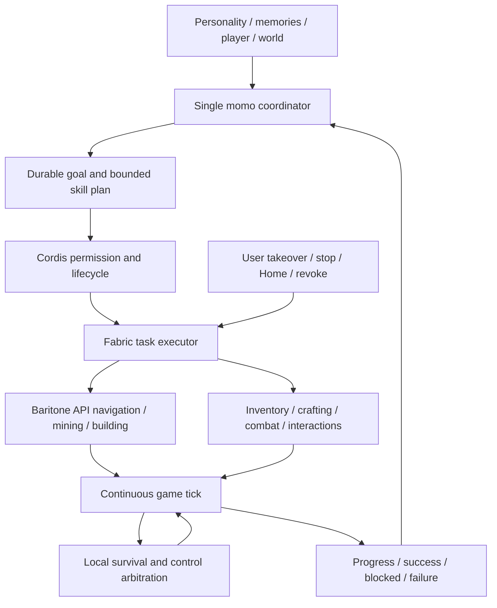
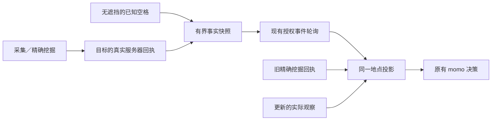
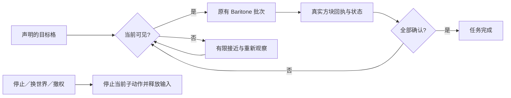

# 007 — Autonomous, continuous Minecraft play

Approved replacement specification, 2026-11-13. Status: implementation in progress; not accepted/done. This is the single active implementation specification. Historical plan and research are evidence, not competing designs.

### 当前交付状态（2026-11-16）

007 尚未完成。已实测导航、视线内采集、精确合成、方块破坏／放置、背包交换、工作站加工／交易、追击近战、死亡后重生和暂停释放；这些是分项证据。完整战斗、其余原版交互／交通／维度等能力组、连续自主游玩、接管／恢复以及最终安装版仍需集中验证。不能因为工具已声明或单项 smoke 通过就标记 done。

| 验收范围 | 已有真实证据 | 仍需验证 |
|---|---|---|
| 感知与探索 | 近处操作方块、约 67 格外可见树冠、探索后接近采集 | 完整异常与未知机制反馈 |
| 移动与导航 | 地表路线、跳跃、游泳、稳定抵达、可选清理通路 | 持续跟随已实测；攀爬及搭路分支的集中覆盖 |
| 采集与建造 | 连续采石 8 块、连续采木 3 根、有界换位采木、可见分批屋顶 25 格、正常破坏与放置回执 | 完整自主建筑与异常恢复组合；最终安装版 |
| 背包与容器 | 交换、拆分、箱子存入、关闭重开核对、完整取回、背包自动取食、四件护甲与副手盾牌 | 满背包采集前停止、正确工具耐久及骑乘背包／装鞍已实测；复杂恢复组合 |
| 制作与加工 | 分批木板、工具、梯子、石剑、箱子、船、熔炉／烟熏炉／高炉、切石机产物与织布机图案 | 材料不足／库存满等加工恢复 |
| 战斗与生存 | 天然骷髅追击近战、弓／弩／三叉戟远程命中、实际盾牌阻挡事件、原版 PvP 追击与击杀、阶梯地形的苦力怕引信避险、低血量脱险、回血跨阈值仍持续撤退、进食、缺氧脱险及死亡后重生 | 更多完整战斗组合与最终集中复查 |
| 世界交互 | 工作台、箱子、门／栅栏门、种植、放船／驾船、矿车放置／移动／上下车、入睡／醒来、下界正常往返、末地框架激活与普通移动进入 | 其余实体／复杂组合的集中覆盖；不能把末地入口当作击败末影龙或出口验收 |
| 原版特殊机制 | 村民交易、附魔与经验扣除、砂轮祛魔、铁砧命名／清除／重复无扣费、取水酿药、下界合金锻造 | 铁砧组合及复杂组合恢复 |
| 社交与协作 | 真实外部玩家聊天、同一协调器在游戏内回复且本地任务持续、普通抛出／拾取给予物品、持续跟随 | 与完整自主目标的集中续接验收 |
| 人格与连续生活 | 同一模型自行组织路线、受阻后修改目标、容量维护后重新取景续接 | 交谈期间挖掘成果、压缩后目标保留已验证；目标实例与成果持久化已实现；完整连续生活与最终重启恢复仍待集中验收 |
| 停止与生命周期 | 暂停屏障、旧继续拒绝、取消及停止释放、原版菜单暂停／继续；真实协调器暂停／继续、停止、插件撤权及运行中 Home，过期命令双层拒绝；实际失焦／返回及客户端退出重启后显式重新授权，旧任务不重放 | 在线服务器关闭时取消与双层旧命令拒绝已实测；手动输入接管、世界切换和安装界面的最终集中覆盖 |
| 本地响应与性能 | 低血量后两个 tick 开始逃险、轻量等待场景停止往返 9.87 ms；同一位置／视角 A-B-B-A 取景对照约 20 TPS、帧率中位数均 105 FPS | 移动中的相同往返路线加密取景已实测约 20 TPS、帧率比约 0.939；战斗及最终安装版的性能与延迟仍待核对，上述分项不能代替整体结论 |
| 交付 | 稳定源码分批推送；desktop `7777683`／shared `cc130a8` 已固定签名安装，来源、资源和数据备份已核对 | 安装界面已实测 Boot、选择现有游戏及启动；发现实际 UI 形象提示导致容量阻塞，本节后续修复尚未晋级。最终全链路 smoke 未完成 |

## Product contract

Control the player's existing Fabric Java 1.21.1 client, account and world. No extra client/account, Docker, Bash, arbitrary generated script, cheats or second reasoning personality. Vanilla common gameplay is supported; modded mechanics are best effort with explicit unsupported feedback. Use normal player knowledge, visible discoveries and exploration memory; collision navigation is allowed, underground resource scanning is not. Unified gameplay permission includes PvP. Target continuous normal-player combat rather than competitive win rates.

The player can say "play on your own" and see sustained, meaningful action without low-level instructions. Game progression, curiosity, aesthetics, helping, social play and rest can all be goals. Local physical execution continues during conversation while every model decision uses the existing single Python coordinator.

## Runtime and interfaces

Retain local authentication, world/account binding, activity epochs, vision eligibility and revoke barriers. Replace short key pulses as the primary API with capabilities, observe, submit, events, cancel/stop. A submit receipt means accepted, never completed. Tasks have queued/running/paused/succeeded/failed/cancelled states and state-based result evidence. One physical owner, bounded queued work, ordered event cursors and snapshot recovery after a gap. Lost replies are reconciled by task ID rather than replaying effects.

Game-thread code must not block on model, HTTP, screenshot encoding or large path search. Input control advances on healthy game ticks; path work uses Baritone's worker machinery. Task heartbeat is independent of model response; identity changes, disconnect, Home, revoke and takeover release controls and clear pending actions. Stop cannot activate reflexes or restart work. Menus pause valid tasks; death terminates execution and returns the decision to momo. Food, shields, weapons and combat coordinate through a single body arbiter.

Plans compose typed skills with bounded sequences, conditions and retries. No arbitrary JS. Keep low-level GUI/slot controls for uncommon mechanics, with honest capability reporting. Replace the old per-minute micro-action count with separate queue, work, time and event budgets.

实际 UI 请求包含形象清单、目标事实和视觉信息。除去重复教程后，仍可能因 UTF-8 保守估算反复触发容量维护。因此游戏回合沿用现有 `usage_anchor` 的真实 provider token 口径：在数据目录、受众、会话代次、模型配置和工具 schema 相同，且从首条 system 开始的连续文本消息哈希匹配时，将旧完整请求的实测用量作为这段前缀的保守上界；新消息和图像继续全额计费。缓存只存哈希、数值和时间，5 分钟过期，最多 32 组／每组 8 个样本，每个样本最多 64 条消息哈希，遇到多模态消息即停止。无可靠用量或前缀不匹配时使用原估算；硬预算和全部权限校验保留。

采集与记忆通过同一事件流核对事实：执行器只发布已确认挖掘目标的方块结果，以及视线段完全无遮挡后确认的空格；不会发布周边所有服务器方块更新。每个世界最多保留 128 条此类事实，带独立序号、维度和原生观察时间，随现有两秒轮询传给 Python。地点投影在任务唤醒决策前移除已失效的旧标记，新观察或再生资源优先于更早的迟到回执。原任务日志保留；已有精确挖掘回执可只读用于历史检索过滤，不查询世界、不恢复许可或重放动作。

探索记忆保存当前世界／账号真正见过的地标；转头或走到别处不会抹去旧观察。模型可通过只读 `places query` 检索较早的记录，每次最多返回六处，附维度与观察时间；结果属于历史，不代表当前仍存在，交互前必须重新观察。默认目标上下文仍只携带少量最近地点，避免不断扩大提示词；检索不读取未知地形、不派发游戏动作、不恢复旧授权。

连续采集先进行有界的视线搜索；找不到可用来源时，执行器最多走到四个附近观察点（相对原点约 12 格），再用相同的第一命中射线观察。仍保留每 tick 16 条射线、任务 2400 tick 和距原点 32 格等限制；没有资源时明确结束，不把已有库存当成新收获。此为接收采集意图后的身体搜索，不新增模型循环或性格目标。 搜索将第一命中的实际表面点交给挖掘，挖掘仍从当前眼睛位置重新射线核验；新遮挡或错误面不会因旧观察而获准，避免只重采方块中心／面中心造成交接漏看。

建造任务按可见批次推进：新的目标格先经过第一命中射线，再读取其状态并交给原有 Baritone 执行；遮挡时最多尝试五个附近接近位置。同一时刻只持有一个子动作，切换前停止并恢复设置。确认格使用实际回执／已存在观察，结束前复查；保留 32 格、每轴 16 格、原点 32 格与 2400 tick 等边界。可以使用自有材料垫脚，结果包含材料库存前后值，垫脚块可能保留。

## Capability matrix

前后台边界（用户 2026-11-13 明确补充）：不要求 Minecraft 在后台游玩。切出游戏是正常操作，不按未知故障调查；移除强制压制失焦暂停的机制，也不改写玩家的暂停偏好。显式开始/继续时可把现有游戏窗口带回前台；切出或打开菜单期间暂停动作和自动决策，切回并关闭菜单后再续接。显式手动接管仍优先，不能因此被自动撤销。

| Group | Required behavior |
| --- | --- |
| Observe/explore | Visible terrain/entities/hazards, own state/inventory/screens, explored memory, unknown/unreachable |
| Navigate | Walk/sprint/jump/sneak/swim/climb/follow/detour/stuck recovery |
| Gather/build | Correct tools, mine until block changes, collect drops, place/build/light with legal reach/materials |
| Inventory | Stack/split/transfer/drop/hotbar/armor/offhand/durability |
| Craft/process | Recipes, player/workbench grids, furnace and vanilla processing screens, real material checks |
| Combat/survival | PvE/PvP pursuit, melee/ranged/shield, eat/equip/retreat/hazard response |
| World | Doors/beds/workstations/containers/entities/farming/transport/dimension transitions |
| Special vanilla | Enchant/brew/trade/anvil with semantic adapters and low-level UI composition |
| Social | Chat, give items, cooperate/follow/help, change goals |

Mechanics are reusable; objectives are not hardcoded recipes such as always acquiring diamonds. No /give, teleportation or creative/admin fallback.

## Goals and presentation

Goal records include source/reason/target/constraints/status/progress/evidence/next step. Important events trigger replanning; one no-event review at most per 30s, no unnecessary model call when nothing changes. Survival is local. Goal snapshot survives context compaction; meaningful experiences enter existing memory, ticks do not. Restart restores intentions only, never authority or side effects. Revalidate world/account/permissions/state before continuation. In-game text is untrusted.

Reuse existing activity entry and plugin cards: start, pause/resume, stop/handoff; show goal/current action/blocked reason, reveal detail on demand. Support zh/en/ja. Keep internal JSON/diagnostics out of dialogue. Chat changes or stops work through the same coordinator; no additional game LLM or history.

## Milestones and evidence gates

1. Pin Baritone 1.21.1 API artifact with checksum/source/license. Compile and real-client probe navigation/gather/path continuity/cancel/takeover and normal-player perception. Do not spread implementation before compatibility is established; remove replaced simple pathing after gate.
2. Implement task engine, events, authority/input arbitration and capability matrix in grouped increments; deterministic checks and bounded real game tests, not repeated installation per small change.
3. Integrate goals/events/chat through existing coordinator, validate independent continuation without operator micro-instructions.
4. Full review, schemas, suites and exact-revision CI; promote business source, sign once with stable identity, installed model smoke and cleanup.

Installed acceptance: autonomous explore→gather→craft→use/build; containers/workstations/transport/dimensions; continuous combat/eat/retreat and authorized PvP fixture; recovery from obstacles/material shortage/full inventory/disappearance/death/disconnect; chat and compact preserve goal; button/chat/manual/Home/revoke stop and reject late effects. Verify actual items/positions/world/screen, not model narration. No step-by-step 300ms/slot hints.

On a healthy 20 TPS local game, target local danger/revoke response beginning within two ticks; no artificial LLM wait gaps during continuous skills; no new visible game stall from path/vision/transport. Record control timing separately from model API latency, plus calls/tokens and outcomes. These are targets, not achieved claims. Retain failures and known limits; archive done only after full accepted scope passes.

## Delivery

Shared source first, one business implementation, batch promotion to macOS. Preserve data/world/config, use additive goal storage, do not restore activity grants. Bundle verified dependencies with provenance/licenses, no external service maintenance. Windows follows macOS acceptance. Keep one latest installed version and necessary development artifacts. Bash and sandbox require separate justified plan and approval if future evidence changes the current decision.

## 实施与验收记录

[分项证据、失败记录和修复回归](evidence/007-minecraft.md) 单独维护；本文件保留产品契约、架构、验收范围与交付要求。当前 007 尚未完成。
