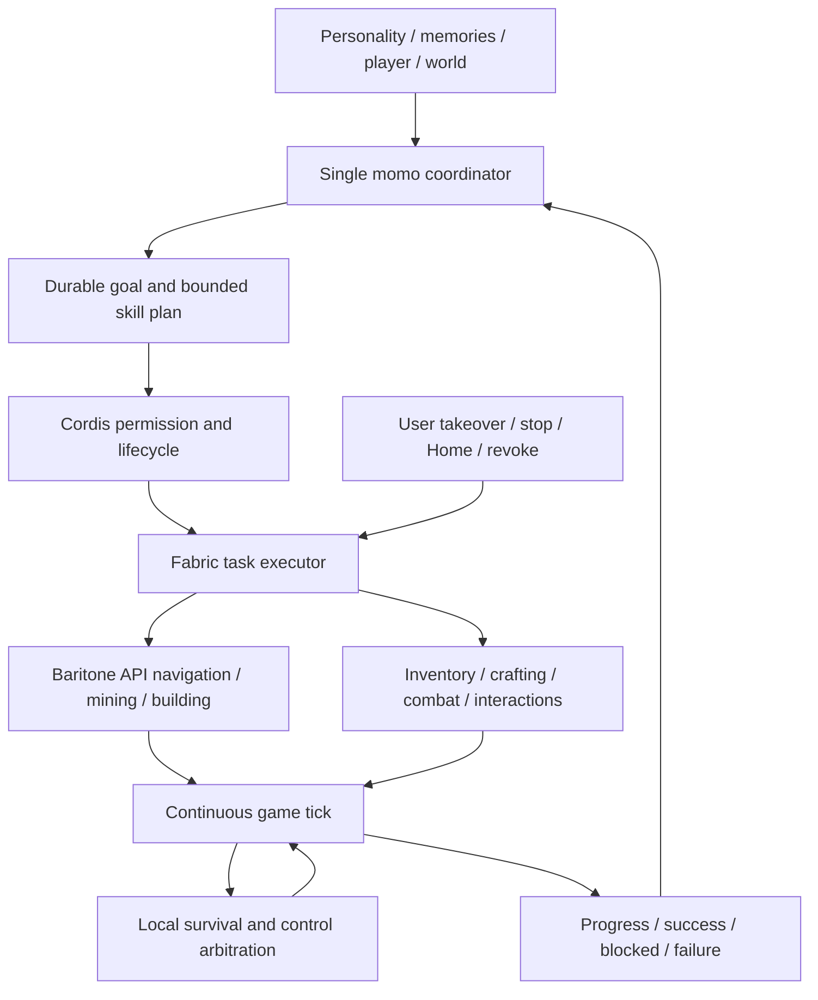

# 007 — Autonomous, continuous Minecraft play

Approved replacement specification, 2026-11-13. Status: implementation in progress; not accepted/done. This is the single active implementation specification. Historical plan and research are evidence, not competing designs.

## Product contract

Control the player's existing Fabric Java 1.21.1 client, account and world. No extra client/account, Docker, Bash, arbitrary generated script, cheats or second reasoning personality. Vanilla common gameplay is supported; modded mechanics are best effort with explicit unsupported feedback. Use normal player knowledge, visible discoveries and exploration memory; collision navigation is allowed, underground resource scanning is not. Unified gameplay permission includes PvP. Target continuous normal-player combat rather than competitive win rates.

The player can say "play on your own" and see sustained, meaningful action without low-level instructions. Game progression, curiosity, aesthetics, helping, social play and rest can all be goals. Local physical execution continues during conversation while every model decision uses the existing single Python coordinator.

## Runtime and interfaces

Retain local authentication, world/account binding, activity epochs, vision eligibility and revoke barriers. Replace short key pulses as the primary API with capabilities, observe, submit, events, cancel/stop. A submit receipt means accepted, never completed. Tasks have queued/running/paused/succeeded/failed/cancelled states and state-based result evidence. One physical owner, bounded queued work, ordered event cursors and snapshot recovery after a gap. Lost replies are reconciled by task ID rather than replaying effects.

Game-thread code must not block on model, HTTP, screenshot encoding or large path search. Input control advances on healthy game ticks; path work uses Baritone's worker machinery. Task heartbeat is independent of model response; identity changes, disconnect, Home, revoke and takeover release controls and clear pending actions. Stop cannot activate reflexes or restart work. Menus pause valid tasks; death terminates execution and returns the decision to momo. Food, shields, weapons and combat coordinate through a single body arbiter.

Plans compose typed skills with bounded sequences, conditions and retries. No arbitrary JS. Keep low-level GUI/slot controls for uncommon mechanics, with honest capability reporting. Replace the old per-minute micro-action count with separate queue, work, time and event budgets.

## Capability matrix

| Group | Required behavior |
| --- | --- |
| Observe/explore | Visible terrain/entities/hazards, own state/inventory/screens, explored memory, unknown/unreachable |
| Navigate | Walk/sprint/jump/sneak/swim/climb/follow/detour/stuck recovery |
| Gather/build | Correct tools, mine until block changes, collect drops, place/build/light with legal reach/materials |
| Inventory | Stack/split/transfer/drop/hotbar/armor/offhand/durability |
| Craft/process | Recipes, player/workbench grids, furnace and vanilla processing screens, real material checks |
| Combat/survival | PvE/PvP pursuit, melee/ranged/shield, eat/equip/retreat/hazard response |
| World | Doors/beds/workstations/containers/entities/farming/transport/dimension transitions |
| Special vanilla | Enchant/brew/trade/anvil with semantic adapters and low-level UI composition |
| Social | Chat, give items, cooperate/follow/help, change goals |

Mechanics are reusable; objectives are not hardcoded recipes such as always acquiring diamonds. No /give, teleportation or creative/admin fallback.

## Goals and presentation

Goal records include source/reason/target/constraints/status/progress/evidence/next step. Important events trigger replanning; one no-event review at most per 30s, no unnecessary model call when nothing changes. Survival is local. Goal snapshot survives context compaction; meaningful experiences enter existing memory, ticks do not. Restart restores intentions only, never authority or side effects. Revalidate world/account/permissions/state before continuation. In-game text is untrusted.

Reuse existing activity entry and plugin cards: start, pause/resume, stop/handoff; show goal/current action/blocked reason, reveal detail on demand. Support zh/en/ja. Keep internal JSON/diagnostics out of dialogue. Chat changes or stops work through the same coordinator; no additional game LLM or history.

## Milestones and evidence gates

1. Pin Baritone 1.21.1 API artifact with checksum/source/license. Compile and real-client probe navigation/gather/path continuity/cancel/takeover and normal-player perception. Do not spread implementation before compatibility is established; remove replaced simple pathing after gate.
2. Implement task engine, events, authority/input arbitration and capability matrix in grouped increments; deterministic checks and bounded real game tests, not repeated installation per small change.
3. Integrate goals/events/chat through existing coordinator, validate independent continuation without operator micro-instructions.
4. Full review, schemas, suites and exact-revision CI; promote business source, sign once with stable identity, installed model smoke and cleanup.

Installed acceptance: autonomous explore→gather→craft→use/build; containers/workstations/transport/dimensions; continuous combat/eat/retreat and authorized PvP fixture; recovery from obstacles/material shortage/full inventory/disappearance/death/disconnect; chat and compact preserve goal; button/chat/manual/Home/revoke stop and reject late effects. Verify actual items/positions/world/screen, not model narration. No step-by-step 300ms/slot hints.

On a healthy 20 TPS local game, target local danger/revoke response beginning within two ticks; no artificial LLM wait gaps during continuous skills; no new visible game stall from path/vision/transport. Record control timing separately from model API latency, plus calls/tokens and outcomes. These are targets, not achieved claims. Retain failures and known limits; archive done only after full accepted scope passes.

## Delivery

Shared source first, one business implementation, batch promotion to macOS. Preserve data/world/config, use additive goal storage, do not restore activity grants. Bundle verified dependencies with provenance/licenses, no external service maintenance. Windows follows macOS acceptance. Keep one latest installed version and necessary development artifacts. Bash and sandbox require separate justified plan and approval if future evidence changes the current decision.

## Implementation ledger — 2026-11-13

- Approved specification committed as `04279ab`, exact-source CI passed.
- Baritone official Fabric 1.11.3 artifact verified against release SHA-256 and embedded 1.21.1/identity/license metadata. Runtime preparation is build-time only, offline at packaging; no runtime downloads.
- Loom compiled real Baritone API calls; final companion nests the unmodified upstream jar (including its native-pathfinder dependency). Lifecycle tests cover local continuation, evidenced arrival, duplicate rejection, cancellation, expired lease and unreachable result. New CI compiles Fabric rather than relying only on Node mocks.
- These are build/lifecycle checks. Real client loading, continuous navigation and manual takeover probe remain pending; later capability/goal milestones have not started. No installed app replaced.

- Real-client probe: existing official launcher/account and test world, nested Baritone and native nether-pathfinder loaded. One submitted goal continued moving without model calls; an invalid-height destination returned unreachable, a valid surface goal returned succeeded/arrived. Scoped navigation disables implicit breaking/placing and restores borrowed settings. A running-task stop was checked against subsequent task/position state. These are direct bridge compatibility probes, not model autonomy acceptance. Menu pause/resume and expired-pause handling have lifecycle tests; actual human-input takeover remains pending.
- GUI tools do not enumerate the Java game window. The test used the official Quick Play singleplayer option to enter the existing temporary world; no extra account/world, inventory injection or teleportation. Launcher credentials were kept in memory and never printed/stored in source. A save-and-return-to-title click exceeded the short command timeout; ping was reconciled to confirm world exit rather than replaying it. This reinforces separating accepted receipts from long operation completion in the next task protocol.
