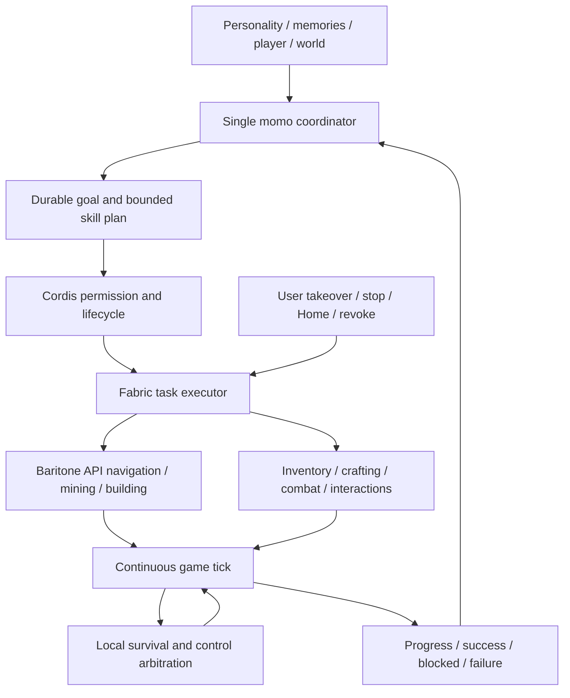

# 007 — Autonomous, continuous Minecraft play

Approved replacement specification, 2026-11-13. Status: implementation in progress; not accepted/done. This is the single active implementation specification. Historical plan and research are evidence, not competing designs.

### 当前交付状态（2026-11-14）

007 尚未完成。已实测导航、视线内采集、精确合成、方块破坏／放置、背包交换、工作台物品转移和暂停释放；这些是分项证据。完整战斗、原版加工／交易／交通／维度等能力组、连续自主游玩、接管／恢复以及最终安装版仍需集中验证。不能因为工具已声明或单项 smoke 通过就标记 done。

## Product contract

Control the player's existing Fabric Java 1.21.1 client, account and world. No extra client/account, Docker, Bash, arbitrary generated script, cheats or second reasoning personality. Vanilla common gameplay is supported; modded mechanics are best effort with explicit unsupported feedback. Use normal player knowledge, visible discoveries and exploration memory; collision navigation is allowed, underground resource scanning is not. Unified gameplay permission includes PvP. Target continuous normal-player combat rather than competitive win rates.

The player can say "play on your own" and see sustained, meaningful action without low-level instructions. Game progression, curiosity, aesthetics, helping, social play and rest can all be goals. Local physical execution continues during conversation while every model decision uses the existing single Python coordinator.

## Runtime and interfaces

Retain local authentication, world/account binding, activity epochs, vision eligibility and revoke barriers. Replace short key pulses as the primary API with capabilities, observe, submit, events, cancel/stop. A submit receipt means accepted, never completed. Tasks have queued/running/paused/succeeded/failed/cancelled states and state-based result evidence. One physical owner, bounded queued work, ordered event cursors and snapshot recovery after a gap. Lost replies are reconciled by task ID rather than replaying effects.

Game-thread code must not block on model, HTTP, screenshot encoding or large path search. Input control advances on healthy game ticks; path work uses Baritone's worker machinery. Task heartbeat is independent of model response; identity changes, disconnect, Home, revoke and takeover release controls and clear pending actions. Stop cannot activate reflexes or restart work. Menus pause valid tasks; death terminates execution and returns the decision to momo. Food, shields, weapons and combat coordinate through a single body arbiter.

Plans compose typed skills with bounded sequences, conditions and retries. No arbitrary JS. Keep low-level GUI/slot controls for uncommon mechanics, with honest capability reporting. Replace the old per-minute micro-action count with separate queue, work, time and event budgets.

## Capability matrix

前后台边界（用户 2026-11-13 明确补充）：不要求 Minecraft 在后台游玩。切出游戏是正常操作，不按未知故障调查；移除强制压制失焦暂停的机制，也不改写玩家的暂停偏好。显式开始/继续时可把现有游戏窗口带回前台；切出或打开菜单期间暂停动作和自动决策，切回并关闭菜单后再续接。显式手动接管仍优先，不能因此被自动撤销。

| Group | Required behavior |
| --- | --- |
| Observe/explore | Visible terrain/entities/hazards, own state/inventory/screens, explored memory, unknown/unreachable |
| Navigate | Walk/sprint/jump/sneak/swim/climb/follow/detour/stuck recovery |
| Gather/build | Correct tools, mine until block changes, collect drops, place/build/light with legal reach/materials |
| Inventory | Stack/split/transfer/drop/hotbar/armor/offhand/durability |
| Craft/process | Recipes, player/workbench grids, furnace and vanilla processing screens, real material checks |
| Combat/survival | PvE/PvP pursuit, melee/ranged/shield, eat/equip/retreat/hazard response |
| World | Doors/beds/workstations/containers/entities/farming/transport/dimension transitions |
| Special vanilla | Enchant/brew/trade/anvil with semantic adapters and low-level UI composition |
| Social | Chat, give items, cooperate/follow/help, change goals |

Mechanics are reusable; objectives are not hardcoded recipes such as always acquiring diamonds. No /give, teleportation or creative/admin fallback.

## Goals and presentation

Goal records include source/reason/target/constraints/status/progress/evidence/next step. Important events trigger replanning; one no-event review at most per 30s, no unnecessary model call when nothing changes. Survival is local. Goal snapshot survives context compaction; meaningful experiences enter existing memory, ticks do not. Restart restores intentions only, never authority or side effects. Revalidate world/account/permissions/state before continuation. In-game text is untrusted.

Reuse existing activity entry and plugin cards: start, pause/resume, stop/handoff; show goal/current action/blocked reason, reveal detail on demand. Support zh/en/ja. Keep internal JSON/diagnostics out of dialogue. Chat changes or stops work through the same coordinator; no additional game LLM or history.

## Milestones and evidence gates

1. Pin Baritone 1.21.1 API artifact with checksum/source/license. Compile and real-client probe navigation/gather/path continuity/cancel/takeover and normal-player perception. Do not spread implementation before compatibility is established; remove replaced simple pathing after gate.
2. Implement task engine, events, authority/input arbitration and capability matrix in grouped increments; deterministic checks and bounded real game tests, not repeated installation per small change.
3. Integrate goals/events/chat through existing coordinator, validate independent continuation without operator micro-instructions.
4. Full review, schemas, suites and exact-revision CI; promote business source, sign once with stable identity, installed model smoke and cleanup.

Installed acceptance: autonomous explore→gather→craft→use/build; containers/workstations/transport/dimensions; continuous combat/eat/retreat and authorized PvP fixture; recovery from obstacles/material shortage/full inventory/disappearance/death/disconnect; chat and compact preserve goal; button/chat/manual/Home/revoke stop and reject late effects. Verify actual items/positions/world/screen, not model narration. No step-by-step 300ms/slot hints.

On a healthy 20 TPS local game, target local danger/revoke response beginning within two ticks; no artificial LLM wait gaps during continuous skills; no new visible game stall from path/vision/transport. Record control timing separately from model API latency, plus calls/tokens and outcomes. These are targets, not achieved claims. Retain failures and known limits; archive done only after full accepted scope passes.

## Delivery

Shared source first, one business implementation, batch promotion to macOS. Preserve data/world/config, use additive goal storage, do not restore activity grants. Bundle verified dependencies with provenance/licenses, no external service maintenance. Windows follows macOS acceptance. Keep one latest installed version and necessary development artifacts. Bash and sandbox require separate justified plan and approval if future evidence changes the current decision.

## Implementation ledger — 2026-11-13

- Approved specification committed as `04279ab`, exact-source CI passed.
- Baritone official Fabric 1.11.3 artifact verified against release SHA-256 and embedded 1.21.1/identity/license metadata. Runtime preparation is build-time only, offline at packaging; no runtime downloads.
- Loom compiled real Baritone API calls; final companion nests the unmodified upstream jar (including its native-pathfinder dependency). Lifecycle tests cover local continuation, evidenced arrival, duplicate rejection, cancellation, expired lease and unreachable result. New CI compiles Fabric rather than relying only on Node mocks.
- These are build/lifecycle checks. Real client loading, continuous navigation and manual takeover probe remain pending; later capability/goal milestones have not started. No installed app replaced.

- Real-client probe: existing official launcher/account and test world, nested Baritone and native nether-pathfinder loaded. One submitted goal continued moving without model calls; an invalid-height destination returned unreachable, a valid surface goal returned succeeded/arrived. Scoped navigation disables implicit breaking/placing and restores borrowed settings. A running-task stop was checked against subsequent task/position state. These are direct bridge compatibility probes, not model autonomy acceptance. Menu pause/resume and expired-pause handling have lifecycle tests; actual human-input takeover remains pending.
- GUI tools do not enumerate the Java game window. The test used the official Quick Play singleplayer option to enter the existing temporary world; no extra account/world, inventory injection or teleportation. Launcher credentials were kept in memory and never printed/stored in source. A save-and-return-to-title click exceeded the short command timeout; ping was reconciled to confirm world exit rather than replaying it. This reinforces separating accepted receipts from long operation completion in the next task protocol.

- The temporary navigation-only lifecycle is replaced by one generic task runtime: five live tasks, idempotent request keys, queued/running/paused/terminal states, independent heartbeat with absolute lifetime, bounded ordered events and gap signal, scoped reset, and stop-uncertainty barriers. Pure-Java lifecycle tests and actual Fabric/API compilation passed. Only navigate is currently advertised; other semantic skills, host/Python continuation and the goal UI are still pending. This generic runtime has not yet been live-game smoke tested.

### 持续技能实现进度（2026-11-13，非整体验收）

Fabric 增加严格声明的语义技能与最多 24 步的本地顺序计划，可按真实库存条件执行、跳过或最多重试两次。Node 与 Fabric 共用同一份数据契约，拒绝未知字段、嵌套计划和脚本。任务结果仍需现场证据；工作站适配目前提供普通槽位 / 按钮路径，不能把 API 路径存在当作全部机制已实测。

已在现有测试存档实测：可见草方块破坏；放置工作台 → 打开 → 合成木棍（0→4）→ 关闭的一次本地连续计划。第一次放置目标与玩家碰撞，未误报成功；换到合法相邻位置后跑通。该探针直接调用执行器，不是模型自主游玩验收。

新增可见实体、已解锁配方、工作站信息；本地存档身份独立于维度，任务额外绑定实际 ClientWorld 实例。物理鼠标输入接管与最新元数据目前只完成构建检查，留待集中真实 smoke。旧短时输入和旧平面跟随仍作为迁移代码存在，正式验收前需移除被替代的控制器。

### 目标、事件续接与玩家入口

目标和实际任务回执增量存入独立表，按世界/角色隔离，不进入 009 的待压缩历史。恢复只加载意图，不重放操作。Python 的身体监视器只续租与同步事件；不调用模型；活动、账号、世界、模型能力或激活租约失效就撤回控制。事件丢失先读快照，不重新提交副作用。

自主决策使用现有 chat SSE、唯一协调器和同一人格。首次启动/任务结束触发评估，无事件最多每 30 秒复查一次；玩家交谈与展示优先。观察事件不会写成玩家说过的话。常用入口加入暂停/继续和当前目标/动作，合并原先分散的游玩权限；没有独立 PvP 开关。

当前检查：后端全量 831 通过、3 平台跳过（随后新增的上下文隔离和自动决策门控等定向 34 通过）；前端 256 通过、类型检查通过。尚未完成真实模型自主游玩、完整原版能力组覆盖或新安装版验收，007 保持进行中。

### 身体与上下文的后续收敛

旧平面跟随控制器已删除，跟随也使用同一任务队列与 Baritone 导航。新增本地生存优先级（危急脱险、持续进食、近身防御），在暂停任务后借用单一身体；停止、菜单和接管优先。截图仅在游戏线程捕获，缩放/PNG 编码移到通信工作线程。补充掉落物拾取、加工结果等待、原版商人交易，以及独立于完成证据的当前步骤进度。

世界授权标识对应存档/服务器，维度独立作为观察事实。传送门引起的 ClientWorld 切换终止当前任务并反馈，再由同一 momo 重新观察；不会把两个本地存档因同为主世界而混为同一身份。

真实模型预检发现：一次观察携带全部已解锁配方，同时请求全部技能定义，会触发 009 的预算保护。本次改为默认少量配方、按需配方查询、单技能参数查询；没有提升或绕过上下文硬上限。该预检尚未进入实际自主操作，修复后需重新做真实模型 smoke。

最近检查：Fabric 真实构建及任务/计划/生存/参数烟测通过；Node 定向 15 通过；Python 定向 39 通过；前端类型检查通过。最新身体、生存、元数据与参数查询变更尚需实际重载模组复测。

### 自主 smoke 暴露的问题与修复

当前配置的真实模型已自行提出“在草地上安个家”的目标，并执行多个连续导航任务；还发现两处实际问题，不能据此整体验收：任务提交后同轮继续轮询，最终耗尽 ReAct 轮数；路径自动拾取与后续 pickup 步骤衔接时，实体已被收走而误报失败。

协调器现于任务接收后结束本轮工具调度（必要时仅做一次无工具的自然回应），后续由任务事件继续驱动；常用技能签名随现有工具声明提供，避免每轮重复查询所有参数。停止时回收本作用域已完成的真实任务回执，未知传输结果撤销绑定，确定的本地输入错误不作未知副作用处理。专注对话会立即释放游戏控制，不再等待身体轮询。该增量已有定向回归测试，真实模型需重新复测。

### 回执与身体连续性修复

- 每次绑定使用持久记录专用的随机活动身份，避免重启后 UI 代次从零开始覆盖历史事实。旧任务表增量迁移；没有终态回执的历史任务标为结果未知，不恢复执行。目标暂停会暂停身体，放弃会取消未完成步骤；有未完成任务时不能直接宣称目标完成。
- 拾取核验使用原版服务端的拾取事件，按世界、角色、实体与提交边界匹配；允许导航先拾取、下一步骤再核验，不能靠实体消失伪造成功。已在同一角色真实丢出树苗、导航、拾回，收到自身服务端回执且背包恢复原数量。切换世界清理回执，避免保留旧世界对象。
- 制作按单次配方产物取出，不再 shift 合成全部原料；等服务器槽位版本更新且光标清空后再判定。本修复有独立证据判定测试和真实 Fabric 构建，精确制作仍需实际复测。
- 本地生存反应允许在任务之间的推理空档继续，但受独立心跳、暂停、菜单、身份与手动接管控制；不会由观察调用授予身体控制。按键接管匹配玩家实际键位。截图编码与通信使用有界工作队列，停止不必排在单一 PNG 编码线程后面。

这些是分项修复证据，尚不构成完整能力矩阵或安装版自主游玩验收。最终集中安装与全能力组 smoke 仍未完成。

### 观察、探索与上下文容量

同一回合的新观察替换过时的只读快照；旧快照保留时间和位置摘要并明确标为过期，不清除动作结果、目标或永久对话。正常压缩重建前缀时也保持该规则。模型投影保留物品与槽位地址，空槽只给地址，配方改为按需查询；完整游戏状态仍可由本地接口读取。目的在于给新画面留空间，不增加或绕过 009 上限。

探索笔记只记录实际站到的位置和当时可见的近处地标，按存档、角色、维度隔离，每个存档角色保留最多 1024 个最近访问区块。它不是地下资源或未知地形扫描器，也不会把每个 tick 写入长期人格记忆。连接发现优先检查新进程，退出后残留的 session 文件不再占满 16 个活动实例结果名额。

### 持续采集与事实保留

增加 `gather(item,count)`：本地以每 tick 最多 16 条普通视线探测可见来源，衔接现有采掘、工具检查与拾取，直到真实背包增加指定数量。寻找木材时可有界清理相应树种的可见近处树叶；不会查询树叶背后的方块来偷看原木。视野中无来源、工具不足或受阻时明确失败，由 momo 决定是否换地方探索，而非无穷扫描或重试。

同一角色实测采到一根橡木原木，背包从 0 增至 1；随后请求再采两根返回来源不可见，未伪造完成。停止请求到释放回执单次观测约 17ms，只是样本，不是 P99 或完整性能结论。更长采集、精确制作、全能力组与安装版仍需继续核验。

步骤计划失败或取消时保留此前已经完成的步骤事实；后续控制是否成功停止与此前实际发生的修改分开记录。预期游戏条件失败使用稳定原因码，界面映射中英日解释，不把内部异常或任意诊断字符串呈现给玩家。Baritone 的异步搜索时限有上界，活动结束后恢复借用的玩家设置。

精确制作复核：同一角色把一根原木制作成四块木板再制作一个工作台；随后自主执行器导航返回已有工作台，打开界面、消耗七根木棍制作三架梯子、关闭界面。实际背包增减与回执一致。制作的版本核验以最后一次取放操作为边界，不能用前一次配方填充的回执证明后一次取放；处理原版槽位版本回绕。该链路已实测通过，尚不代表所有加工和交易界面已完成真实验证。

### 输入归属、暂停屏障与服务端事实

按用户确认的前台游玩方式执行，不要求后台控制；玩家切到其他应用或打开菜单时暂停，显式继续才返回现有游戏窗口，不修改原版暂停偏好。手动接管或暂停记录时间边界，旧推理请求不能覆盖更新的玩家决定；取消任务和释放按键也不能顺便清除暂停。真实游戏已确认：暂停后新任务与低层动作均被拒绝，旧继续请求被拒绝，取消后仍暂停，新玩家请求可以继续，最终释放按键为零。

采掘由当前技能持有破坏输入，避免原版空闲处理每 tick 取消进度。进食、拉弓、盾牌等持续使用动作显式持有使用键；停止统一释放。服务端方块更新提供有界回执，采掘和放置不再用客户端预测证明完成。同一角色真实采掘草方块及放置泥土均收到匹配的服务端方块更新。持续使用和战斗改动目前为构建及确定性测试证据，尚无真实战斗验收。

交易改为逐份取出并核验最后一次放入背包的回执，避免一次购买全部库存；等待加工可指定药水类型。有限计划对结果未知的副作用不自动重试或跳过，保留已确认的部分成果。任务终态释放执行对象，回执按摘要和实际槽位变化记录，避免长期持有世界和界面对象。

本增量检查：Python 定向 64 项、Node 定向 19 项、前端类型检查、Fabric 构建及纯逻辑 smoke 通过。全原版能力组、真实模型连续自主链路、集中安装和最终验收仍在进行，007 未完成。

### 自主恢复与连接模组更新

真实模型复测发现，Node 适配器正确区分了参数拒绝，但标准输入输出协议丢失错误码，使 Python 把未执行的参数错误误判为结果未知并撤销整场活动。协议现在仅保留有界的 Minecraft 错误码，不暴露运输诊断；真实子进程管道回归通过。真正未知的外部副作用仍停止，不会盲目重试。

增加地表导航选项 `navigate(...,height=surface)`：普通户外探索可沿地形升降；精确楼层导航保持原有默认值。仍限制已加载的近处目标，不允许挖掘、搭桥、地下资源扫描或传送。模型说明明确区分使用物品的快捷栏 0～8 与界面槽位 36～44，避免混用。

玩家选择现有实例后，“安装／更新连接模组”可原子替换已确认属于 momo 的旧连接模组。根据 Fabric 标识和客户端入口识别，保留其他模组；符号链接、同名外来文件拒绝覆盖。写入失败保留旧资源，不让玩家手工删除模组才能更新。游戏仍需正常重启加载新模组。

后续预算修复：任务接收后的无工具自然回应可以继续使用同一未修改前缀的服务端 token 计数作为保守上界，因为移除工具只会减少请求；添加或修改工具、修改前缀仍废弃计量锚点。没有增大上下文窗口、跳过容量保护或删掉动作事实。该边界回归通过，长程自主复测仍遇到其他容量情形，继续诊断，不能视为已解决全部上下文问题。

普通背包／工作站槽位操作同样等待最后一次操作之后的服务端版本变更，不能只凭客户端堆叠变化宣称成功；没有回执的副作用按未知结果处理。最新模型实测挖掘任务累计获得 15 块泥土，中途取消／范围受阻的记录保留了真实部分收获。尚未完成全部能力组和连续自主目标验收。

进一步诊断确认：退休旧游戏快照会修改已计量的前缀，导致预算退回字节上界，实测约 8k token 的请求被估成 29k～47k。现在仅对这项已知替换保留原上界，并额外计入整段替换文本，不扣除被删内容；其他未经计量的前缀修改仍使锚点失效。幂等替换不重复计费，有独立回归测试。此项仍需后续真实模型复核。

物品标识统一使用原版命名空间规则，`oak_log` 与 `minecraft:oak_log` 含义相同，保留模组自己的命名空间；用于采集、条件和等待加工结果匹配。危急脱险或近处敌人可以打断 momo 自己打开的工作站，取消旧界面任务、释放控制后再防御；不会关闭玩家菜单，也不会因为普通饥饿放弃正在进行的界面操作。

### 整轮审查后的控制边界修复（继续进行）

最新真实模型回归 12 次调用、11 次工具操作，没有上下文或模型错误，完成近处地表导航和多步泥土搭建；背包操作仍暴露确认问题，尚未整体验收。一次独立整轮代码审查发现控制边界、界面所有权、回执和恢复问题，按实际影响统一修复，不把已有局部成功当作全功能完成。

- 自主游戏事件只获得 Minecraft、记忆搜索／新增和时间工具；模型即便返回未声明工具名，执行层也拒绝 QQ、MCP、其他应用和偏好修改。不会为游戏事件重新打开或重配主人的拓展连接。真人直接对话保留原有能力，仍共用同一人格和协调器。
- 暂停立即释放低层按键；在游戏线程执行前检查前台、玩家接管、菜单和场景。旧世界任务先收束，再接受新世界操作，换维度后必须重新观察。
- 保留 momo 自己打开的具体工作站界面，允许跨任务观察和操作；不接管玩家已经打开的界面。玩家在 momo 的界面点击、滚动或输入会交还控制。死亡画面仍允许观察与重生决策。
- 未确认释放时不启动排队任务或生存反应。取消计划保留当前子步骤的真实部分收获；制作／交易的不确定确认超时不能跳过后继续副作用。
- 连接协商失败撤销临时绑定；已知前台／参数／忙碌拒绝不误报未知结果。暂停入口匹配实际游玩权限，切换后强制刷新，旧在途状态不能覆盖新状态。

### 槽位与工作台回执复核

原版在客户端预测正确时不会为每次槽位点击返回更新。momo 对自己发出的原版点击使用不同的槽位版本请求服务端完整重同步；槽位、按钮、操作和物品内容保持原点击含义，不追加第二次操作，也不改变真人点击。每一步等待当前世界／界面、实际目标槽位与光标一致的服务端快照，不能用无关背包变化证明加工成功。加工等待只检查相应原版工作站的输出槽。

真实客户端已通过背包交换及换回，工作台中 14 块泥土取放后全部归还；界面可跨任务保留，停止时仅关闭 momo 自己打开且光标为空、控制已释放的界面，真人接管时保留界面。放置工作台替换草丛也已核对服务端实际工作台方块，不再把草丛消失后的空气误认成放置完成。暂停前仍持有前进键的回归测得 350ms 内位移为零，最终释放按键为零；这是单次实测，不是 P99 或完整反应时限结论。

失败采集现在保留物品、维度、位置、视线探测数和实际失败原因；同一地点重复失败会向唯一协调器提供换区域／换方法的事实提示，不硬编码下一个目标。战斗技能不再被重复的防御反应打断；危急脱险仍优先于进食和战斗。后两项生存策略目前为确定性测试证据，实际战斗仍未验收。

后续真实模型回归跑通多次地表探索、种植与受阻恢复，但未完成木材／工具／采石的完整目标。发现地表模式仍按无用的目标高度计算距离，已改为仅限制相同的 64 格水平半径；精确模式保持三维限制，实际客户端用目标高度 0 的近处地表任务复测通过。自主事件主动停止游玩后立即结束本轮，不再在已撤销的游戏绑定上执行后续工具或输出迟到内容；该回归由失败测试转为通过。仍不视为整体验收。

实际追击自然生成的动物时，发现到达移动目标的旧位置被误判为路径不可达；现改为目标变化后续接新路径，短暂遮挡只追踪最近实际可见位置，最多两秒，不读取遮挡后的目标位置。真正不可达仍返回明确原因。导航抵达需连续四个有支撑的 tick，避免跳跃／下落途中误报；地表目标在落稳前不会因路径进程结束就提前失败。抵达后恢复可观察前方的俯仰角。这些新增判断已通过确定性回归与 Fabric 构建；完整追击／战斗复测尚未通过，不能据此宣称战斗可验收。

### 远近感知的衔接

真实自主探索仍未跑通原木／木镐／圆石的完整目标。结构化观察此前仅提供近处约 6 格的操作方块，远处可见树木主要依赖模型从画面估计位置。补充 `visibleLandmarks`：每次观察最多 120 条、48 格的普通视线，只读取射线首先命中的已加载原木、树叶和工作站等地标，去重最多 6 项；近处操作方块保持独立。不会查询树叶后面的原木或地下矿物，也不扩大导航许可半径。采集仍交由同一个本地 gather 技能持续执行，不增加模型循环。

新增感知有遮挡／无命中／距离／去重／采样数量回归，Fabric 全部 20 项构建任务通过。最新客户端已确认返回地标字段，在没有命中的位置正确返回空列表；正向树林导航与后续采集链路仍在验证，不能提前计为自主链路完成。最新全量后端 869 项通过、3 项平台跳过，预算窗口测试现在显式覆盖一分钟前、临界点和之后，避免依赖 CI 机器已启动多久。

上述增量已有确定性回归和真实协议管道测试；最终战斗、加工、交通、维度与安装版测试仍未完成，007 保持进行中。
