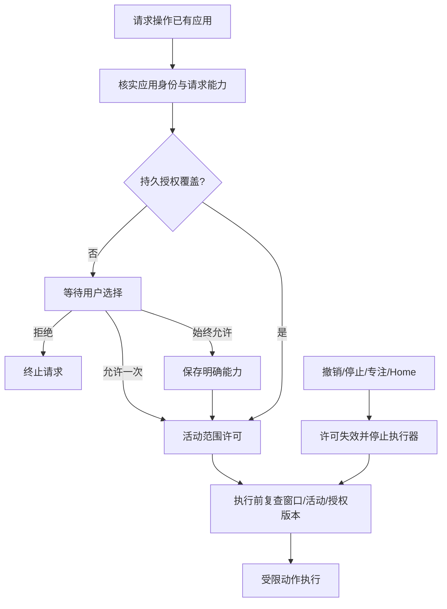

# 016 应用操作授权与后续迭代

状态：实现与验证中；不是 OS sandbox；不提供 Bash。用户最终澄清优先于此前 sandbox 描述。

## 当前实现规则

- 插件启用、应用授权、当前活动三层独立。启用插件不自动开始观察/操作。
- 真实应用身份由本地执行器解析：bundle ID + canonical应用路径；PID/窗口ID仅绑定当前目标，不作为永久授权身份。
- 操作前产生唯一请求ID，显示应用、申请能力和原因；提供允许一次/始终允许/拒绝。
- 允许一次作用于当前请求对应的活动，有有效期，停止或活动撤销即失效。始终允许仅保存明确批准的能力，后续活动可复用；不是全电脑授权。
- 观察与操作分别授权，批准子集不能被请求方扩大。当前grant有效期5分钟，持久allowlist不等同于永不失效的执行令牌。
- 拒绝/过期的相同请求不能自动重弹或自动执行；新活动需要新的请求。失联/重启不得重放旧操作。
- 允许列表支持删除；删除先更新授权版本，再停止对应活动，执行前后复查。停止失败不恢复授权。
- 设置内维护允许列表，Chat内展示当前请求；仅本机当前Boot持有人可批准，外部QQ消息/网页文字/模型都不能批准自己。
- 执行器限定目标窗口，执行前复核应用身份、PID、窗口位置和前台；动作仅点击、有限文字和滚动，不提供任意脚本或Shell。
- 这是应用操作授权，不隔离被控制程序本身的文件/网络副作用。macOS屏幕录制/辅助功能权限仍需系统授权，不能通过产品allowlist绕过。

## Codex参考与证据边界

参考官方app-server协议的唯一approvalId、请求与响应关联、权限子集和scope分离：https://github.com/openai/codex/blob/main/codex-rs/app-server/README.md 。momo的“始终允许应用”是面向本产品的持久规则，不把Codex的turn/session规则误称同一范围。

工具明确禁止访问Codex应用，不能声称已逐帧查看其UI。逐帧视觉/交互对齐待用户截图或录屏；不绕过工具限制。公开源码研究不替代真实UI观察。

## 后续迭代与待验收

- 2026-11-05：后端全量728 passed / 3 skipped；授权UI smoke 4/4（含模型发起请求、等待当前回复结束后继续）；原生host定向测试5项通过，含真实窗口清单和旧binding拒绝。这些不替代真实输入E2E。
- 批准后仅凭服务端保存的requestId继续，不能由前端替换窗口；忙碌时只返回明确waiting状态。撤销不等待在途动作锁，旧binding不能作用于后继活动。
- 真实辅助功能授权后，对专用临时应用验证请求→允许→动作→撤销→动作拒绝。
- 应用重安装/签名改变的身份增强：加入代码签名身份，避免仅路径/bundle复用。
- 浏览器按站点细分、敏感提交动作独立确认，依据实际需求迭代，不默认扩大权限。
- 用户可见授权历史和失败原因；不会存储屏幕像素或输入敏感文本。
- Windows对应权限与目标窗口一致性验证。
