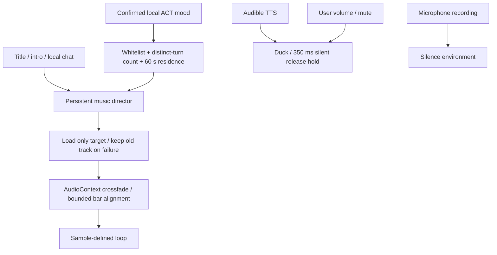

# 014 / 015 implementation ledger

2026-11-05 — full first production version, awaiting final listening acceptance. The earlier two-sketch build (66cd5ae) was accepted; this iteration completes the catalogue and OST rather than moving them to follow-up.

## Production and ownership

Original score + deterministic additive/FM synthesis, no third-party samples or generative music model. GitHub music-composition guidance informed motif development, game loops and dialogue-friendly arrangement; beatflow was studied for explicit timing only, not copied or installed. See `audio/RESEARCH.md`.

Six 32-bar game loops and six separately arranged 48-bar OST versions: title, first connection, daily, night, uplift, comfort. Complete source, editable JSON, Standard MIDI with section markers, four real stems per OST, 48 kHz / 16-bit WAV/FLAC masters, browser audition MP3, credits, track order and reproducible lossless ZIP. `audio/README.md` documents durations, formats and reproduction. Eleven effects in each of two palettes cover accepted UI interactions, intro completion and new phone notifications. Existing backlog does not ring; notifications have a five-second cooldown.

## Runtime rules

- Title chooses title; first-meeting intro chooses connection; chat chooses daily or night (22:00–06:00 local). Settings/Log preserve music position. Phone/QQ events never select BGM.
- Optional existing ACT channel accepts only neutral/bright/quiet/comfort, at most one cue per local reply. No extra LLM request and no model-specified URL. Ordinary mood changes need two distinct consistent turns and 60 seconds of current-track residence; comfort immediately fades to the low-intensity comfort track. Invalid/missing cues retain the current scene, not guessed emotion.
- Same-tempo transitions align to the next bar only when within one second; otherwise bounded 1.2 s gain crossfade. Different tempos are not force-matched. Playback uses the audio clock, not JS timer loop chaining.
- At most two decoded music buffers / fifteen total cached buffers, four simultaneous effects, 90 ms per-effect cooldown, 15 s fetch timeout. Rapid scene changes cancel stale fetches; returning to an aborted target starts a fresh request. Late effects are skipped. Cached muted audio cannot restart itself.
- TTS actual RMS lowers environment gain; repeated silent RMS does not indefinitely postpone release. Microphone capture silences music and effects. User mute takes precedence. Hidden/unfocused pages suspend while preserving playhead; Web Lock coordinates foreground ownership where supported. Autoplay requires user gesture.
- General → environment audio: independent SFX/music volumes (zero=mute), warm/glass palette and preview, persisted in settings and localized zh/en/ja. No new global toolbar controls.

## Validation / acceptance boundary

Frontend 241 tests; backend 729 passed / 3 skipped; production build passed. Three-language 1280×720 settings checks cover visibility and persisted mute. Real browser decoding checks all six game WAVs. Offline QA repeats loop boundaries three times, checks finite samples/DC/peaks, verifies stem reconstruction and FLAC hashes. OST measurements span −22.12…−21.57 LUFS and −9.81…−8.36 dBTP. This is technical validation, not a claim of headphones/speakers listening approval.

Final acceptance remaining: user listens to full arrangements and the game mix. Cover art, external publishing and arbitrary music generation were not requested or implemented. Plans remain awaiting acceptance, not prematurely archived.
