# 013：原生识图（待维护者验收）

首版使用主 LLM 的 OpenAI 兼容图文协议，不配置第二个视觉模型，不自动更换玩家模型。

## 使用

设置 → 模型 → 识图：先测试，再开启。测试只发送程序生成的六位数字图，需要模型正确读出内容；HTTP 200 或 `/models` 可达不足以通过。结果按地址、密钥和模型保存为服务端指纹；任一变化需重测。关闭始终可用。鉴权/网络失败与“未确认能看图”分别处理。

Chat 粘贴图片后显示附件条，准备完成后可以逐张删除、重试和发送；支持纯图片。失败保留附件和文字，不自动去掉图片重发。最多4张、每张源文件10MiB。PNG/JPEG/WebP/GIF经真实解码，20MP上限，最长边1536px、编码后单张3MiB，透明区域合成白底并清理元数据；GIF只取第一帧并标示。暂不包括拖拽、视频、连续屏幕采样。

图片可在Log和QQ手机消息中查看，点击缩略图放大。放大后可明确确认删除原图；文字记录与不可用的附件引用保留，后续不再向模型发送被删除原图。

## 数据与权限

- 图片BLOB在当前私有SQLite内，永久事件只引用随机ID。备份随数据库；无独立远程图片URL、任意路径或网页抓取。
- 未发送草稿可删除，24小时后清理未被可见记录引用的孤立草稿。历史不因空间不足静默淘汰；当前私有图片容量上限256MiB。
- QQ `media.incoming`只读取已授权入队事件的peer/message/element，要求media权限且白名单、群范围、账号和策略版本一致；不授予history。历史取图仍要求history。
- 共享平台视觉处理，不为QQ开第二个推理循环。读取和模型发送前都复核授权/配置；当前回合取消、专注或切号沿现有协调器撤销。
- 后台请求暂时展开data URL，文本日志、工具结果、摘要、记忆都不存base64。图片内文字仅是外部内容。

## 上下文与009

近期最多4张图片随上下文重放（超出则保留引用），使用按标准化像素网格估算的保守视觉预算，而非base64字符数；仍受当前模型窗口的009比例预算/硬上限约束。该估算不是供应商精确tokenizer，实际usage继续校准009。窗口不足会报容量错误，不截断事实后冒充完整看图。

compact只总结已发生的对话观察并保留有关图片ID，不额外把原图发给摘要模型。`image_read`可按确切引用重新读取当前受众已保存图片，再将图片投影到同一个推理回合。图片不会自动成为长期记忆。

## 验证边界

自动测试使用隔离配置、随机生成图片和合成OpenAI服务。浏览器合成服务根据真实PNG像素识别专用数字模板及RGB色块，验证协议没有忽略图片，不代替真实模型质量评测。QQ集成测试穿过协调器、Cordis与原生worker，只有QQNT SDK为合成实现；不连接真实QQ、不替玩家发消息。

## QQ接收可见性修复

QQ收取消息元信息与读取附件字节分开：普通图片在media关闭时也进入接收队列，表情、商城表情包及其他未知元素以名称/类型/未展开提示保留，混合消息按原顺序投影。账号、receive、白名单、群范围和身份验证仍照常检查。未知元素不把原生对象或本机路径直接送给模型。消息过长会明确标注未展开部分，不静默丢弃整条。

普通图片及以图片形式发送的表情，media开启后即可读取并展示原图；只有经验证的vision开启后才发送给模型。商城表情、内置表情和图片文件会尝试解析实际图像资源，再进入同一套图片处理。原图大小未上报时允许有界下载，下载后仍核验真实文件和体积上限。

## 真实 QQ 下载回归（2026-11-03）

两处断点已定位：开发资源闭包仍带旧 worker；QQNT 下载成功时可能返回消息的 `picElement.sourcePath` 私有缓存路径，而非请求的临时路径。开发启动器先校验完整闭包，再仅同步本仓库 worker 及其哈希，不修改厂商原生资源；其他资源被篡改时拒绝同步。

下载回执必须匹配消息和元素；返回路径必须等于请求路径或该确切消息元素声明的缓存路径，并位于独立账号目录内，通过规范路径、所有者、非符号链接、单链接普通文件和体积校验。仅删除 momo 自建临时文件，不删除 QQ 自有缓存。实际解码决定 MIME，不信任文件名扩展名。

手机和 Log 使用同一份 `run_images` 图片引用。媒体接收与模型视觉开关解耦；下载失败不能让模型臆测“权限没开”。真实只读探针已从玩家测试消息取回 106458 字节 JPEG（1026×1026），并验证模型请求构造包含实际图片字节；经玩家明确授权后，使用当前模型配置实际识别成功，读出“哦鲸鲸...”及蓝发女仆形象；未更换模型或密钥。

参考：[QQagent 图片读取/回退与预处理](https://github.com/shuang-ying/QQagent/blob/5daf184a3d198b06b86ba058d6510562da5f23a1/src/llm/media.ts)、[QQagent 图片及表情段识别](https://github.com/shuang-ying/QQagent/blob/5daf184a3d198b06b86ba058d6510562da5f23a1/src/llm/vision.ts)、[NapCat 原生下载接口的返回路径处理](https://github.com/NapNeko/NapCatQQ/blob/98d781d19815d1625b24d717ce280ecf0a4f6d0c/packages/napcat-core/apis/file.ts)。QQagent 依赖 OneBot，本项目沿用原生 QQ，不引入外部网关；这里只参考其取字节、真实解码和错误分层方式。

用户原始文字单独存入收件箱 display_text；手机/Log 使用该字段和实际图片，模型侧的附件注释不再显示。旧记录仅按对应图片附件移除既有自动占位，原始事件不改写。手机对话移除内部操作回执，诊断仍留在内部账本。

原生图片预算回归：多个历史像素重放可能挤爆默认上下文窗口。每次请求及摘要发布后的重建均按当前模型 safe 预算与真实工具定义移除最旧的可选历史像素；历史文字、图片引用、手机/Log 原图及当前输入像素不删。当前输入本身放不下时仍由009硬兜底拒绝，不假装看过。玩家数据副本复现请求从51562降至20731（safe=26050），仅保留当前像素。

```mermaid
flowchart TD
  A[Chat 输入 / 粘贴 / 麦克风] --> C[对话输入：用户文字、转录、图片引用]
  B[QQ 原始消息] --> G[核验账号、发送者、当前消息与媒体权限]
  G -->|图片 / 收藏图 / 表情| I[取真实像素并生成受限图片引用]
  G -->|语音| V[本地解码并使用内置 SenseVoice 转录]
  G -->|文本| C
  I --> C
  V --> C
  C --> R[复核授权并进入同一 run_turn / 上下文 / 工具循环]
  R --> D{有可交付回复？}
  D -->|有| S[按渠道呈现或发送，回执后记账]
  D -->|QQ 生成错误或空输出| F[仍获授权时发送简短兜底，避免重复发送]
  G --> P[原始消息展示投影]
  P --> L[Log 按生活时间线]
  P --> Q[手机按账号和联系人]
```

语音转录与用户文字同级。模型可以看到当前获准的图像与转录；阅读记录时保留原消息的媒体类型。专注、退出和权限撤销优先于回复。发送结果不明时等原命令回执。
