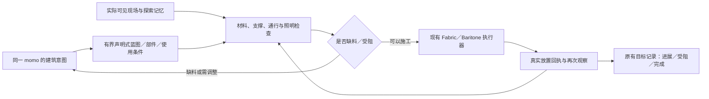

# minecraft-build-design 与 007 的取舍

2026-11-16，用户提供的补充参考。源码检查固定于 [e6b2b65d83ba28e67d49406579f3bc68749d0db4](https://github.com/yimeng-YM/minecraft-build-design/tree/e6b2b65d83ba28e67d49406579f3bc68749d0db4)。这是源码调研结论，不是 momo 已接入、已运行其工具包或已完成建造验收的声明。

## 它解决的具体问题

它让编程助手用 Python 描述建筑，读取可选地形，生成 Litematica / WorldEdit 文件、预览、材料清单和检查报告。不是持续操作生存角色的执行器，也没有代替 momo 的人格与目标循环。

| 源码 | 机制 | 对 momo 的价值 |
|---|---|---|
| [build.py](https://github.com/yimeng-YM/minecraft-build-design/blob/e6b2b65d83ba28e67d49406579f3bc68749d0db4/scripts/mcbuild/build.py) | 坐标→方块状态、命名部件、局部坐标旋转；门、床等成对结构 | 把建筑意图保存为声明式目标，而非反复让模型口述逐格微操作 |
| [materials.py](https://github.com/yimeng-YM/minecraft-build-design/blob/e6b2b65d83ba28e67d49406579f3bc68749d0db4/scripts/mcbuild/materials.py) | 按物品计算成本：门上半部／床头不重复计数、双层台阶计两个；标记特殊工具和创造专用材料 | 施工前核对当前库存与缺料，按部件准备；它本身不负责采集或合成 |
| [verify.py](https://github.com/yimeng-YM/minecraft-build-design/blob/e6b2b65d83ba28e67d49406579f3bc68749d0db4/scripts/mcbuild/verify.py) | 文件独立解码、支撑／多格结构检查；半格列碰撞 BFS 验证指定目标可达 | 将“房子完成”细化为门口、内部、箱子等实际可用条件，不能只数已放方块 |
| [light.py](https://github.com/yimeng-YM/minecraft-build-design/blob/e6b2b65d83ba28e67d49406579f3bc68749d0db4/scripts/mcbuild/light.py) | 发光、衰减、面遮挡的有界网格传播 | 提前检查蓝图暗区；实际完工仍核对游戏照明与使用路径 |
| [design-guide.md](https://github.com/yimeng-YM/minecraft-build-design/blob/e6b2b65d83ba28e67d49406579f3bc68749d0db4/references/design-guide.md) | 功能→体量→外观→内部、分部件、地形适配与施工可行性 | 给 momo 建造时可用的原则，不写死唯一房型或科技树 |

## 保留现有执行架构

这是建议采用的职责划分，尚未作为新功能整体接入。蓝图是数据，不执行模型生成的 Python／JS；模型仍在唯一协调器内决定设计、采集与改变计划。本轮不因此增加 Bash。建筑任务可分批执行，但分批成功不能自动等于建筑可用。

目前已落地其中的建造续接：复用现有不可变任务请求，提供同一目标下的分页建造索引，再通过原活动／任务 ID 取回完整方块布局和真实回执。它不创建第二个蓝图库，不扫描存档地形，也不把请求坐标当作已经存在的方块。材料核算、通行与照明分析仍是待进一步接入的部分，不能把该索引表述为整个参考项目已整合或住所已验收。

不整体搬入以下流程：

- 存档、Voxy／Bobby 缓存的任意地形读取。007 的现场来源仍是正常玩家观察；未知地下或未见地形不能因为有存档文件就成为模型知识。
- Litematica 粘贴作为生存施工。其 [IngameTest.java](https://github.com/yimeng-YM/minecraft-build-design/blob/e6b2b65d83ba28e67d49406579f3bc68749d0db4/scripts/mcbuild/harness/src/main/java/dev/mcbuild/harness/IngameTest.java#L80-L110) 切换旁观、设置时间，并调用 `schematic.placeToWorld`，再逐格比较。这个测试证明投影可粘贴，不证明能合法获取材料、接近、摆放与恢复施工。
- 编程助手 shell／安装整个 skill。momo 不因此取得系统命令或源码执行能力，也不新增独立模型循环。

## 复用前的核对项

- 内置事实数据基于 1.21.11。[compat.py](https://github.com/yimeng-YM/minecraft-build-design/blob/e6b2b65d83ba28e67d49406579f3bc68749d0db4/scripts/mcbuild/compat.py) 为 1.21.1 写入 DataVersion 3955、处理名称转换和新增方块排除；这不等于全部 1.21.1 形状／物理规则已实测。momo 已绑定的 1.21.1 注册表与真实结果优先。
- 抽象检查有边界：Walker 将门／栅栏门／活板门当作可打开的通道；替换疑似玩家建筑的检查是警告。不能把其 `PASS` 当作所有门均可通过、不会误拆或完成实际操作的证明。
- [MIT 许可](https://github.com/yimeng-YM/minecraft-build-design/blob/e6b2b65d83ba28e67d49406579f3bc68749d0db4/LICENSE.txt) 允许复用；复制代码须保留版权与许可，并按 [第三方声明](https://github.com/yimeng-YM/minecraft-build-design/blob/e6b2b65d83ba28e67d49406579f3bc68749d0db4/THIRD_PARTY_NOTICES.md) 分别检查依赖。此次没有复制其实现或添加依赖。

当前完整自主休息处（封闭空间、门、屋顶、照明、箱子）的目标仍未完成；此调研不改变原验收条件。
