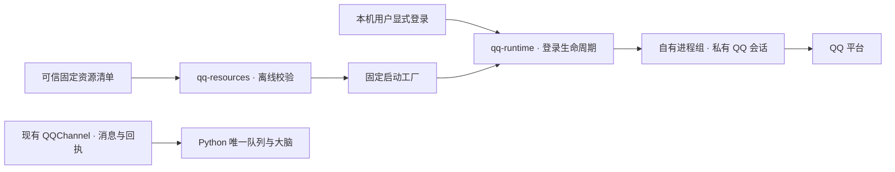

# QQ 受管运行时：当前边界

004 由 momo 管理 QQ 个人号运行资源、独立会话与设置内登录。新的原生链路不依赖 Docker、外部网关或签名服务；设置 → 拓展 → 插件 → QQ 提供账号、权限、记录。登录管理器、固定启动工厂、原生 worker、Cordis / Python API 与设置界面已接入。macOS 本机已通过真实二维码、账号恢复、好友私聊、模型回复和匹配的原生发送回执；生命周期与每次资源升级仍须单独验证，不以模拟测试替代真实收发。

登录不授予聊天权限：`connect {transport: "managed"}` 才在核验实际身份后启用渠道。用户界面只提供一个「退出登录」，对应内部 `qq.runtime.forget`：先持久停用 QQ 收发并提升策略版本，单独撤下 QQ 适配器，再停止自有进程树并清理私有登录目录，不等待其他 MCP 插件。失败明确报错，业务保持停用；权限、白名单、身份绑定、聊天与记忆保留。普通关闭窗口或应用保留凭据，内部 `stop` 不再作为另一种用户退出方式。

QQChannel 通过相同管理器的私有 IPC 复用现有消息准入、渠道上下文和回执账本。Python 继续是唯一推理 / 记忆 / 注意力协调器。QQ 产品路线只保留受管原生连接；旧 Docker / 外部桥接原型不再作为兼容要求，内置通路失败不会回退到旧执行器。

当前原生 worker 只初始化受测 QQ 原生接口，不加载完整 NapCat Shell 或厂商应用入口，不修改厂商文件、签名和 RunAsNode fuse。平台连接回调不当作账号认证；必须收到实际原生登录身份并匹配绑定，随后等待正向会话就绪与启动调用成功完成；过期、取消、掉线及不匹配身份不能发布连接。二维码及核验阶段有截止时间；刷新使用全新自有进程以避免原生回调串到另一尝试。退出首先收束 QQ 自有进程树，其他插件慢关闭不能拖延它。

## 登录恢复、刷新与诊断

普通开始可恢复明确绑定账号的私有会话。传输已连接的控制 ACK 立即返回，不等待 `getLoginList` 或 `quickLoginWithUin` 完成；恢复仍受核验截止时间约束。缓存中的账号资料或快速登录调用被接受，不算账号认证，必须等待原生登录成功回调，并继续等待 `onOpentelemetryInit({is_init:true})` 与原生 startup 成功返回。普通的初始化通知、请求 ACK 或等待超时都不算就绪；好友 UID 缓存不用于核验自己的账号。初始 `MSF(1,0)` 是启动快照，不能据此将账号判为已上线；连接建立后的离线通知会立即撤销权限。

冷启动不登录 QQ、不激活 momo。成功的显式 Boot 才为已启用、未隔离且绑定过的账号安排一个有截止时间的后台恢复任务；页面续接不会另开任务。恢复不写账号设置、不提升权限、不清除专注或手机暂停；会话就绪后按当前权限重新绑定业务。账号停用、换号、未知投递或运行实例被替换时，旧任务失效。

协调器使用内部 `qq.runtime.restore`，在原生管理器中同时比较 attempt 和私有登录版本后才允许开始。取消、停止、手动刷新和清理会使旧快照失效，后台任务不能替换用户的新登录。私有版本仅通过内部状态选项读取，不进入 HTTP 账号接口。一个工作线程合并最新的显式 Boot 请求，并在每次取请求前检查自身生命周期，旧线程不能消费新实例的请求。

「刷新二维码」与「重新扫码」在旧自有进程完全停止后创建新尝试，明确跳过会话恢复，不删除已有票据。认证成功后的迟到二维码/扫码通知不能使状态倒退或清除核验期限；恢复失败触发的真正二维码回退仍可展示。窗口观察与认证生命周期分开，关闭弹窗不等于退出账号。

确认退出登录后，下次开始跳过缓存恢复，直到当前有效尝试真正完成身份认证才解除该限制。扫码中间状态、旧回调、普通停止或清理失败均不能解除；持久停用也阻止下次 Boot 自动恢复。退出时已提交的发送仍按原命令保留未知状态及真实迟到回执，不改写成确定失败、不重发。

内部阶段耗时记录保存于私有 `controlRoot/diagnostics.json`，最多64项，权限0600，按固定字段和阶段白名单写入。记录仅含当前尝试、阶段、耗时及可选整数结果/退出码，不保存原生日志、账号、路径、二维码或票据，也不通过账号状态 API 或模型暴露。诊断失效不改变认证或进程归属。

原生私聊事件可能只提供好友 UID，数字账号暂为空或为零。worker 先核对收发双方 UID 一致、确为好友及消息类型；缺少数字账号时，使用原生 `UixConvertService.getUin` 查询该 UID 的精确映射，并复核已有数字字段没有冲突。查询失败、超时或映射不一致的消息拒绝进入大脑，不使用资料缓存猜测联系人。有限队列保持来信顺序，查询后的事件仍须属于当前连接；取消、掉线或替换尝试会撤销在途事件。诊断只记录批次大小及有限的接受 / 拒绝代码，不记录 UID、账号或正文。此归一化处理不改变登录证明，也不代表真实对端收发已验收。

## 原生候选

已在 macOS arm64 对固定资源组合进行独立验证：QQ `6.9.95-48517`、QQNT / Electron `37.1.0`、Node `22.16.0`、模块 ABI `136`、N-API `10`。

原创启动器加载未修改的 QQNT 框架，调用其导出的 `ElectronInitializeICUandStartNode`。该入口保留厂商的 RunAsNode 检查；没有改动 fuse、厂商二进制或签名，也不执行系统 QQ 的应用入口。此路线通过了原生模块加载与私有目录下的内核、登录配置初始化；无须先启动 Chromium 浏览器进程。

受控初始化在禁止网络、禁止读取日常 QQ 数据的 OS 屏障内完成。完整私有资源包的 431 个文件、19 个内部符号链接通过了资源校验，随后同一个包也通过了离线内核初始化。一次获得明确许可的连接探针观察到 `connect()` 返回 `true`、`onLoginConnected` 回调及 `getMsfStatus() === 1`；这几个观察值不等于二维码可用、平台认证成功或真实消息可收发。

厂商资源和账号资料不在 Git 中。跨机器安装与依赖分发条件仍是后续关口；本机扫码和真实聊天通过不代表已完成公开安装体验，也不把公开安装器的许可推及 QQ 或其他底层组件。

现成 Shell 的 `NAPCAT_WORKDIR` 只控制 NapCat 文件；macOS QQ 的 global、登录 `commonPath`、会话 `account_path` 需要分别指向私有目录。系统 QQ 的原始入口还会在 JavaScript 前选择应用组和热更新，现成 Mac 安装器也会修改该入口并共享登录资料。这些方式不能直接用作独立插件实例；后续账号会话与热更新路径仍须实测。

此前 GUI 探针的 GPU 参数准备失败已定位到错误的 `--browser-subprocess-path` 覆盖值。仅移除该参数后该错误消失，但 GUI 路线仍未到自有 JS。不能把原来的报错当作嵌套隔离必然不兼容的证据。

## 两个独立模块



### 资源校验

`plugin-host/src/qq-resources.mjs` 的 `qualifyQQResources({ root, manifest })` 只接受可信服务端提供的固定清单。它核对私有目录归属、完整文件清单、摘要、元数据及依赖闭包，返回冻结的路径和预期版本信息。它不安装、下载或执行资源，不扫描系统 QQ，也不能从清单字段证明实际运行 ABI。

清单 `schemaVersion: 1` 包含：

- 固定的 `resourceId`、`version`、`platform`、`architecture`、`nativeABI` 与 `qq` 版本；不使用 `latest`。
- `roles`：框架、major、wrapper、原创原生 bootstrap、原创 worker、隔离 profile 与元数据文件。
- `entries`：普通文件的 `{ path, sha256 }` 或显式固定的内部链接 `{ path, symlink }`；`dependencyClosure` 覆盖全部条目。

QQNT 框架原有的 `Versions/Current` 等内部链接保留原状。未声明的链接、越界、循环、替换、缺失文件及校验过程中发生的文件变化均拒绝。常规 QQ 应用入口、asar 和 `app_launcher` 不在此窄运行资源合同内。

结果是某一时点的校验快照。启动工厂仍须在实际使用前复核，并在运行期间保护资源树；不能把一个先前的校验结果当成永久授权。

### 登录生命周期

`plugin-host/src/qq-runtime.mjs` 的 `QQRuntimeManager` 拥有独立于消息配置的引擎生命周期。构造时不启动；显式 `begin` / `refreshQR` 建立新 attempt；取消、断连或重启后旧 attempt 的事件失效。默认状态不包含二维码，经过本机鉴权的接口才可请求短期二维码详情。

可信启动工厂缺失时明确返回 `RESOURCE_UNAVAILABLE`，不自动猜路径、下载资源或使用旧 QQ 登录。生产 transport 只启动服务端准备的固定 `sandbox-exec` 调用，不接受账号请求中的 argv、环境或任意管理命令。为 QQ 子进程预先创建并校验 `dataRoot/home`（0700、当前用户所有、无符号链接），仅在该子进程环境将 `HOME` 与 `CFFIXED_USER_HOME` 指向同一私有目录。父进程环境不变，OS 屏障的 `USER_HOME` 仍使用真实用户主目录，不能因重定向而放开日常 QQ 数据。

原生旧数据导入代码直接读取进程环境；遗漏 `HOME` 会导致空指针，随后由崩溃报告器延迟触发 SIGABRT。只适配 JavaScript 的 `os.homedir()` 无效；仅提供 `HOME` 也不足以重定向 Foundation 的 `NSHomeDirectory()` 与 Application Support。隔离的 Foundation 探针确认，两个子进程变量一致时这些路径才落在专用 Home 内，不需要伪造应用沙箱标识或修改厂商代码。运行时拥有独立进程组；直接父进程退出不等于后代已停止，忘记会话前须确认进程组静止。

worker 在初始化内核之前注册原生 O3 事件分发监听器，回调为空，不提供不透明数据或伪造签名。worker 的控制通信使用有界的 `MOMO_QQ_IPC ` JSON 帧。原生日志不转发到用户错误、模型或状态。每次认证消息关联 attempt；到期二维码撤下，账号不匹配时拒绝连接。当前模块不转发 `inbox` / `receipt`，避免把无发送关联的事件当成真实业务事实；消息与迟到回执仍由现有渠道适配器负责。

## 开发者离线准备资源

`scripts/prepare-qq-runtime.py` 将**已整理且经过审核的资源包**转换成当前源码对应的受管运行目录。它不是 QQ 下载器或安装器，也不从 `/Applications/QQ.app`、日常账号目录或热更新目录寻找资源。输入是符合上方 `schemaVersion: 1` 合同的私有资源包，以及独立审核过的固定清单；不能把未知包自己提供的摘要当成可信来源。

```sh
python3 scripts/prepare-qq-runtime.py \
  --source-package /absolute/private/reviewed-qq-package \
  --source-manifest /absolute/private/reviewed-qq-manifest.json \
  --destination /absolute/private/new-momo-qq-runtime \
  --sdk-path /Library/Developer/CommandLineTools/SDKs/MacOSX15.4.sdk
```

路径必须是绝对、规范路径。目标的父目录须已存在、属于当前用户且不可被其他用户写入；目标自身必须尚不存在，并位于 Git 检出之外。SDK 路径按本机已安装的版本明确选择。可用 `--node`、`--clang` 选择资源包之外的开发工具；工具只运行离线校验器和原创启动器的编译，不运行资源包中的厂商二进制，也不重新签署厂商文件。

准备过程先用生产环境的 `qualifyQQResources` 校验完整源清单，再复制并重新核验相同的资源闭包。复制文件时逐层使用不跟随符号链接的目录句柄，防止校验后的路径替换使复制越界。随后仅保留厂商的 Frameworks / Resources 子树，替换旧控制代码、生成原创 `Info.plist`、复制当前 worker 和隔离 profile，并使用指定 SDK 编译原创 launcher。最后生成全部文件摘要和固定元数据，再次执行完整校验。

成功后输出 `runtime-config.json` 的路径，不启动引擎。配置严格包含 `privateRoot`、`resourceRoot`、`manifestPath`、`dataRoot`、`controlRoot`、`canaryPath` 六个字段；会话与控制目录为 `0700`，配置、清单和 canary 为 `0600`。新目录内不带任何旧账号会话。已有目标即使为空也拒绝覆盖，资源升级与现有会话迁移须另行设计，不借准备工具删除账号资料。

目前只准备已验证的 QQ `6.9.95-48517` / Electron `37.1.0` / Node `22.16.0` / ABI `136` / N-API `10` 组合。校验通过仍不等于平台允许登录或聊天。第三方资源的使用与分发条件须分别核对；本工具不把项目代码许可扩展到 QQ、运行时或其他厂商素材，资源文件不提交到本仓库。

运行合成资源测试：

```sh
uv run --project backend --frozen python -m pytest scripts/test_prepare_qq_runtime.py -q
```

测试核对错误摘要、现有目标保护、符号链接拒绝、Git 目录拒绝和失败清理。编译步骤使用惰性测试替身；测试不会加载 QQ、联网或建立账号会话。

## 验证与下一步

在 `plugin-host/` 运行 `npm test`。资源测试使用合成文件，生命周期测试包含真实的惰性 Node 子进程与后代回收，不登录 QQ；这些测试通过不代表平台登录 E2E 通过。

上述工厂、worker、API、界面和受管传输已在源码接入。启动环境导致的原生崩溃已定位并修复，账号与会话就绪已实际核验。2026-10-27 的真实好友私聊在约 1.46 秒内从入站得到平台发送成功回执；入站、推理、发送载荷、原生消息 ID 与展示记录的 21 项关联校验全部通过，只产生一次发送。该回执证明平台接受发送，不代表对方已读。旧 Docker 当时已停止，临时实验模块已移除，使用的是主干源码 worker。

维护者已授权退出旧测试原型，产品不保留外部传输入口。完整生命周期、重启恢复及维护者体验验收继续按各自关口核对；跨机器资源安装/分发不由这一次本机收发证明。

同机实际重启检查已确认：title 待机时原生引擎未启动；只点击 Boot 后，原生账号与消息通路自行恢复，账号配置指纹不变，完成发送计数仍为 5，没有调用手动登录/连接接口，也没有重发旧消息。专注及返回 title 的检查均保留账号登录，业务按各自状态暂停。

## 固定源码参考

- [Electron 37.1 Node 初始化](https://github.com/electron/electron/blob/v37.1.0/shell/app/node_main.cc)
- [Shell 内核与登录路径](https://github.com/NapNeko/NapCatQQ/blob/v4.18.41/packages/napcat-shell/base.ts)、[会话路径](https://github.com/NapNeko/NapCatQQ/blob/v4.18.41/packages/napcat-core/index.ts)
- [NapCat 工作目录](https://github.com/NapNeko/NapCatQQ/blob/v4.18.41/packages/napcat-common/src/path.ts)、[固定发行](https://github.com/NapNeko/NapCatQQ/releases/tag/v4.18.41)
- [Mac 安装器与共享目录说明](https://github.com/NapNeko/NapCat-Mac-Installer/blob/d2d15e6288a23287dabfc35378fa9b4735e84b2d/README.md)
- [NapCat 许可原文](https://github.com/NapNeko/NapCatQQ/blob/v4.18.41/LICENSE)

- [原生 SDK 的账号会话就绪与启动生命周期](https://github.com/lc-cn/qq-native-mirror/blob/a2d543def70f66703b8f70c37a6e5da992f0e294/sdk/src/runtime/account-session-lifecycle.ts)
- [独立宿主的事件分发注册](https://github.com/NapukettoDev/NapukettoQQ/blob/15df7476692bde286a72e8d8d57573af763c6619/packages/loader/src/host/core/self-host.ts)
