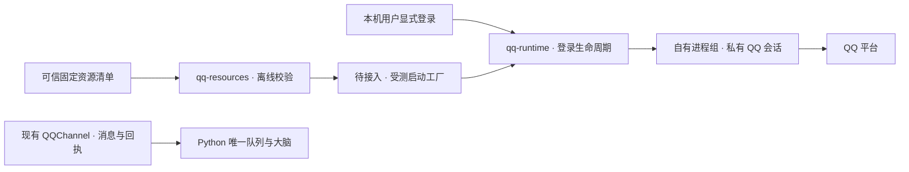

# QQ 受管运行时：当前边界

004 的目标是由 momo 管理 QQ 个人号运行资源、独立会话与设置内登录。玩家不需要维护 Docker、外部网关或签名服务。当前在线聊天仍使用既有 QQ 适配器；下面的基础模块尚未接入宿主、账号 API 或界面，不能作为完整 QQ 插件已交付的依据。

## 原生候选

已在 macOS arm64 对固定资源组合进行独立验证：QQ `6.9.95-48517`、QQNT / Electron `37.1.0`、Node `22.16.0`、模块 ABI `136`、N-API `10`。

原创启动器加载未修改的 QQNT 框架，调用其导出的 `ElectronInitializeICUandStartNode`。该入口保留厂商的 RunAsNode 检查；没有改动 fuse、厂商二进制或签名，也不执行系统 QQ 的应用入口。此路线通过了原生模块加载与私有目录下的内核、登录配置初始化；无须先启动 Chromium 浏览器进程。

受控初始化在禁止网络、禁止读取日常 QQ 数据的 OS 屏障内完成。完整私有资源包的 431 个文件、19 个内部符号链接通过了资源校验，随后同一个包也通过了离线内核初始化。一次获得明确许可的连接探针观察到 `connect()` 返回 `true`、`onLoginConnected` 回调及 `getMsfStatus() === 1`；这几个观察值不等于二维码可用、平台认证成功或真实消息可收发。

厂商资源和账号资料不在 Git 中。安装时准备运行资源的方式、依赖分发条件、真实扫码与聊天仍是后续关口；不把公开安装器的许可推及 QQ 或其他底层组件。

现成 Shell 的 `NAPCAT_WORKDIR` 只控制 NapCat 文件；macOS QQ 的 global、登录 `commonPath`、会话 `account_path` 需要分别指向私有目录。系统 QQ 的原始入口还会在 JavaScript 前选择应用组和热更新，现成 Mac 安装器也会修改该入口并共享登录资料。这些方式不能直接用作独立插件实例；后续账号会话与热更新路径仍须实测。

此前 GUI 探针的 GPU 参数准备失败已定位到错误的 `--browser-subprocess-path` 覆盖值。仅移除该参数后该错误消失，但 GUI 路线仍未到自有 JS。不能把原来的报错当作嵌套隔离必然不兼容的证据。

## 两个独立模块

### 资源校验

`plugin-host/src/qq-resources.mjs` 的 `qualifyQQResources({ root, manifest })` 只接受可信服务端提供的固定清单。它核对私有目录归属、完整文件清单、摘要、元数据及依赖闭包，返回冻结的路径和预期版本信息。它不安装、下载或执行资源，不扫描系统 QQ，也不能从清单字段证明实际运行 ABI。

清单 `schemaVersion: 1` 包含：

- 固定的 `resourceId`、`version`、`platform`、`architecture`、`nativeABI` 与 `qq` 版本；不使用 `latest`。
- `roles`：框架、major、wrapper、原创原生 bootstrap、原创 worker、隔离 profile 与元数据文件。
- `entries`：普通文件的 `{ path, sha256 }` 或显式固定的内部链接 `{ path, symlink }`；`dependencyClosure` 覆盖全部条目。

QQNT 框架原有的 `Versions/Current` 等内部链接保留原状。未声明的链接、越界、循环、替换、缺失文件及校验过程中发生的文件变化均拒绝。常规 QQ 应用入口、asar 和 `app_launcher` 不在此窄运行资源合同内。

结果是某一时点的校验快照。启动工厂仍须在实际使用前复核，并在运行期间保护资源树；不能把一个先前的校验结果当成永久授权。

### 登录生命周期

`plugin-host/src/qq-runtime.mjs` 的 `QQRuntimeManager` 拥有独立于消息配置的引擎生命周期。构造时不启动；显式 `begin` / `refreshQR` 建立新 attempt；取消、断连或重启后旧 attempt 的事件失效。默认状态不包含二维码，经过本机鉴权的接口才可请求短期二维码详情。

可信启动工厂缺失时明确返回 `RESOURCE_UNAVAILABLE`，不自动猜路径、下载资源或使用旧 QQ 登录。生产 transport 只启动服务端准备的固定 `sandbox-exec` 调用，不接受账号请求中的 argv、环境或任意管理命令，也不改写 `HOME`。它拥有独立进程组；直接父进程退出不等于后代已停止，忘记会话前须确认进程组静止。

worker 的控制通信使用有界的 `MOMO_QQ_IPC ` JSON 帧。原生日志不转发到用户错误、模型或状态。每次认证消息关联 attempt；到期二维码撤下，账号不匹配时拒绝连接。当前模块不转发 `inbox` / `receipt`，避免把无发送关联的事件当成真实业务事实；消息与迟到回执仍由现有渠道适配器负责。

## 验证与下一步

在 `plugin-host/` 运行 `npm test`。资源测试使用合成文件，生命周期测试包含真实的惰性 Node 子进程与后代回收，不登录 QQ；这些测试通过不代表平台登录 E2E 通过。

下一步依次完成受测启动工厂与原生 worker、真实二维码及账号核验、设置内登录 API/UI、现有消息适配器的受管传输接入，再验证 Boot、专注、权限和未知投递屏障。只有新链路通过验收后才替换当前通信原型，004 保持进行中。

## 固定源码参考

- [Electron 37.1 Node 初始化](https://github.com/electron/electron/blob/v37.1.0/shell/app/node_main.cc)
- [Shell 内核与登录路径](https://github.com/NapNeko/NapCatQQ/blob/v4.18.41/packages/napcat-shell/base.ts)、[会话路径](https://github.com/NapNeko/NapCatQQ/blob/v4.18.41/packages/napcat-core/index.ts)
- [NapCat 工作目录](https://github.com/NapNeko/NapCatQQ/blob/v4.18.41/packages/napcat-common/src/path.ts)、[固定发行](https://github.com/NapNeko/NapCatQQ/releases/tag/v4.18.41)
- [Mac 安装器与共享目录说明](https://github.com/NapNeko/NapCat-Mac-Installer/blob/d2d15e6288a23287dabfc35378fa9b4735e84b2d/README.md)
- [NapCat 许可原文](https://github.com/NapNeko/NapCatQQ/blob/v4.18.41/LICENSE)
