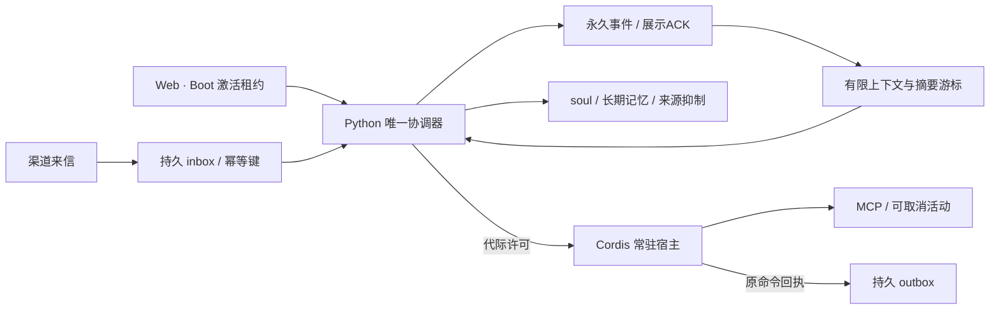

# v3 运行边界与验证

每份数据目录由 OS 锁独占，锁放在可替换目录之外。Python 承担整回合队列；SQLite 事务只保护落盘，不能代替队列。Cordis 的依赖与 effect 生命周期不构成安全沙箱，首版只加载自有宿主内的审核适配器。

运行时默认 dormant；title、冷启动和账号连接不能执行人格推理或插件业务。用户显式 Boot 后建立激活租约；15 秒租约、约 5 秒续期，设置 / 历史保留激活，返回 title 封闭派发并确认停止后待机。有效会话刷新可重接；旧 sessionStorage、重启和外部来信不能自行 Boot。无法确认停止时保持 fault。实际已发出的网络副作用不能撤回，迟到回执只记原命令事实。

私有 NDJSON v1 仅通过父子进程管道使用，每次启动重新绑定 coreInstance / hostInstance 和随机令牌。宿主独立心跳上限 5 秒，许可含 epoch / runId / commandId / 到期时间；进程 EOF 会回收自己的连接与子进程。宿主协议和测试见 [plugin-host](../../plugin-host/README.md)。

玩家已明确启用的通用 MCP 保留 `mcp.tools` 授权；审核渠道声明自己的能力与账号范围。chat 与手机共享一个注意力槽；用户插话先封闭新派发并收束手机执行，再由唯一大脑理解。专注对话暂停全部插件业务，独立的用户暂停不会因关闭专注而消失。通用 MCP 本身可以执行任意服务能力，不能根据工具名称可靠推断副作用，也不能声称沙箱隔离。不要把平台执行藏在未分类 MCP 中。

新凭据服务只向审核适配器暴露不透明引用，按插件绑定、声明 ∩ 用户授权 ∩ 活动权限检查；保存在私有 profile 隔离目录，默认备份不带走。QQ 先核验授权：现有登录 scope 只证明身份和资料，不能充当普通好友双向聊天。当前通信原型使用审核的 OneBot 连接；真实客户端须登录并核验身份，协议测试不等于普通账号已通过。账号设置与连接密钥保存在独立的私有 profile 中，不随生活备份导出。

账本保存原文、稳定 eventId / runId / source / externalMessageId 和诊断状态；展示 / 送达 ACK 决定什么进入对话与记忆。压缩只有版本化摘要和覆盖游标，不删除原文。旧槽只读保留，迁移先一致备份并在副本转换；本版本不能重建历史版本早已删掉的文本。手动遗忘会清除相关投影、抑制旧来源并使旧推理代际失效。

恢复前撤销全局活动、暂停收件消费；恢复后暂停，旧队列和 outbox 不自动重放。整包备份仍会包含现有用户配置中的 LLM/TTS 密钥，界面明确提示妥善保管；新 OAuth 凭据私有存储不随包导出。

初识的姓名确认与澄清次数也以实际展示 ACK 为准。生成失败或尚未展示时，进度不提前完成；迟到 ACK 可提交原回合结果。恢复备份会保留已观察进度并更新代际，未展示的暂存姓名及其向量不会留成隐藏记忆。

MCP 调用一旦已派发，超时 / 断线只说明结果未知。内核持久保留原命令并暂停；重启、重复撤权或重新配置都不能自动解除。核对外部实际结果后，仅可信后端的 `reconcile_command(command_id, "completed" | "failed")` 可以记录终态；模型没有恢复权限。官方渠道记录页提供经本机能力鉴权的人类核对入口，绑定账号与原命令；已知结果可确认终态。无法核实投递但执行器已静止时，`closed_unknown` 保留未知证据并隔离插件；明确恢复新消息才重新验证连接，不重发旧命令。人工核对后可恢复仍有效的激活所有者；没有原所有者时只恢复待机，仍需显式 Boot。MCP 连接断开会撤下其工具目录，下次正常配置协调可重连；轻量方法 ACK 不覆盖完整执行回执。

## 测试分层

- Python：真实 SQLite 迁移 / 备份 / >100 条历史、摘要冲突、失败和部分 ACK、遗忘、队列与租约竞争、恢复。
- Node：真实 MCP 子进程常驻 / 卸载 / EOF、心跳失联、过期许可、旧配置不能重启禁用插件，未知网络副作用保持暂停。
- 浏览器：初识健康检查 / 失败输入、标题演出、设置返回、分页回顾、跨页 ACK、租约冲突和重启恢复。真实 LLM 为显式 opt-in，素材与密钥只在私有测试目录。
- 原生：固定 Web revision 晋级后的 macOS 冻结包，验证随包 Node、单实例与退出回收。Windows 另行推进。

上下文策略当前只做不丢原文和有限投影的必要修正；更完整的压缩 / 目标稳定机制等待 v3-009 与夜羽共同研究。

## 004 / 005 额外合同

- 接受的输入持久化到同一 inbox，普通任务保留 seq，用户插话与明确挂起项可按规则越过；模型和注意力最大并发均为 1。普通重启保持待机。
- chat 的生成完成不释放演出槽：逐字文本、TTS / cue 完成才提交绑定所有者、run、generation 和 token 的演出 ACK。子页安全暂停及历史回放各自受许可控制；展示 ACK 不能确认社交 run。
- QQ 消息身份包含平台、momo 账号、对端及发送者，重投持久去重。白名单可选，开启后空名单拒绝全部；最终发送再次检查当前权限版本与固定收件人。
- 原文、摘要、长期记忆及向量按 audience 过滤，跨平台主人身份须一次性入站挑战证明。外部联系人不能修改激活、专注、账号权限或 soul。
- 平台接受、客户端观察与已读是不同证据；不从 API 成功或本地气泡推断真人已读。微信原型已归档，当前无运行适配器或启动脚本；旧消息与真实回执保留，旧收件任务不能执行。既有未知发送可由已鉴权的本机用户确认旧执行器已停止后结束等待，仍记 `closed_unknown` / `unknown`；不重新连接或激活，后续执行需要显式 Boot。详见 [接入边界](personal-channels.md)。
