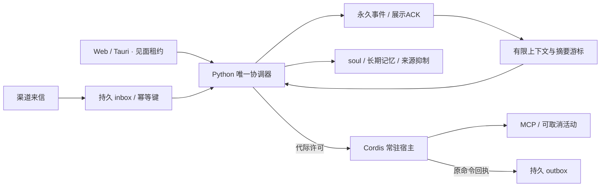

# v3 运行边界与验证

每份数据目录由 OS 锁独占，锁放在可替换目录之外。Python 承担整回合队列；SQLite 事务只保护落盘，不能代替队列。Cordis 的依赖与 effect 生命周期不构成安全沙箱，首版只加载自有宿主内的审核适配器。

见面先撤销旧 epoch、取消推理 / 活动并等待停止 ACK；无法确认停止则保持暂停。15 秒客户端租约、约 5 秒客户端续期；设置 / 历史保留租约，标题明确离开。刷新轮换 leaseId，旧窗口输入和 ACK 被拒。失联不会自动恢复游戏 / 浏览器。已发出的网络副作用不能撤回，迟到回执只记原命令事实。

私有 NDJSON v1 仅通过父子进程管道使用，每次启动重新绑定 coreInstance / hostInstance 和随机令牌。宿主独立心跳上限 5 秒，许可含 epoch / runId / commandId / 到期时间；进程 EOF 会回收自己的连接与子进程。宿主协议和测试见 [plugin-host](../../plugin-host/README.md)。

玩家已明确启用的通用 MCP 保留 `mcp.tools` 授权；审核的渠道 / 游戏 / computer 适配器须声明真实权限，在见面期间禁止。通用 MCP 本身可以执行任意服务能力，不能根据工具名称可靠推断副作用，也不能声称沙箱隔离。不要把平台执行藏在未分类 MCP 中。

新凭据服务只向审核适配器暴露不透明引用，按插件绑定、声明 ∩ 用户授权 ∩ 活动权限检查；保存在私有 profile 隔离目录，默认备份不带走。OAuth / OIDC 仍需对应平台提供真实接口，后续平台计划实现提供方授权流程；当前没有伪造的通用登录或个人微信能力。

账本保存原文、稳定 eventId / runId / source / externalMessageId 和诊断状态；展示 / 送达 ACK 决定什么进入对话与记忆。压缩只有版本化摘要和覆盖游标，不删除原文。旧槽只读保留，迁移先一致备份并在副本转换；本版本不能重建历史版本早已删掉的文本。手动遗忘会清除相关投影、抑制旧来源并使旧推理代际失效。

恢复前撤销全局活动、暂停收件消费；恢复后暂停，旧队列和 outbox 不自动重放。整包备份仍会包含现有用户配置中的 LLM/TTS 密钥，界面明确提示妥善保管；新 OAuth 凭据私有存储不随包导出。

## 测试分层

- Python：真实 SQLite 迁移 / 备份 / >100 条历史、摘要冲突、失败和部分 ACK、遗忘、队列与租约竞争、恢复。
- Node：真实 MCP 子进程常驻 / 卸载 / EOF、心跳失联、过期许可、旧配置不能重启禁用插件，未知网络副作用保持暂停。
- 浏览器：初识健康检查 / 失败输入、标题演出、设置返回、分页回顾、跨页 ACK、租约冲突和重启恢复。真实 LLM 为显式 opt-in，素材与密钥只在私有测试目录。
- 原生：固定 Web revision 晋级后的 macOS 冻结包，验证随包 Node、单实例与退出回收。Windows 另行推进。

上下文策略当前只做不丢原文和有限投影的必要修正；更完整的压缩 / 目标稳定机制等待 v3-009 与夜羽共同研究。
